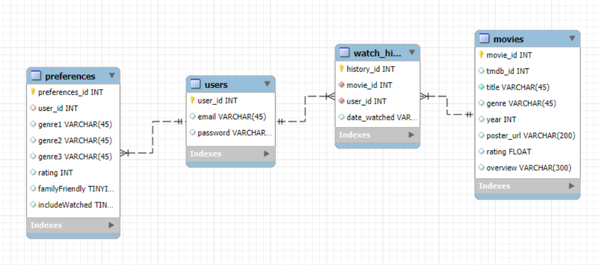

# Cinema_Selector
The Cinema Selector is a movie selector that uses your preferences and watching habits to pick the perfect movie for you.

# Project Overview  
Cinema Selector is a web app built for people who want to track a personal movie collection and struggle to decide what to watch. Rather than scrolling through a list, the app can randomly recommend a title from your library, keep a history of what you have already watched, and let you set viewing prefereneces (favorite genre, minimum rating, family-friendly filter) to tailor your future picks.
- Randomizer: Shows 3 recommended movies at a time. Movies earn points for genres the user has watched before (+3 for favorite genre), with rating as a tie-breaker. Each click picks 3 movies from the top 20 matches. New users with no history get picks from the highest-rated movies.
- Watch History: Mark movies as watched, then search, filter by genre, sort by date, or remove them.
- Preferences: Save up to 3 favorite genres, a minimum rating, a family-friendly filter, and whether to include watched movies.
- Library: Shows the entire movie database library. You can sort through the catalog, and identify the movies you have watched/didn't watch.
- About: Has the TMDB credits and simple project info.
- Login: Firebase Authentication.

Tech: HTML/CSS/JS, Bootstrap. Node.js + Express. SQLite. TMDB API. Firebase.

# Running the Website Locally
Requires Node.js 18+, VS Code with Live Server, a TMDB account, and a Firebase account.
1) Install dependencies using these commands in terminal: git clone <repo-url>... cd Cinema_Selector/movie-selector-backend... npm install
2) Create backend/.env file (see '.env.example' for details): The TMDB token is under TMDB Setting, at API. The Firebase values are under Firebase Project Settings, at your apps.
3) Set up the database to create movies.db using this command: npm run seed
4) Start the backend on http://localhost:3000 using this command: npm start
5) Open the frontend by going to the frontend/index.html page then opening with Live Server. Keep the backend running.

# Database Design
SQLite database in movie-selector-backend/movies.db:
- movies: Movie catalog from TMDB: id, tmdb_id (unique), title, genre, year, poster_url, rating, overview
- watch_history: One row per watched movie: id, movie_id (FK), users_id (FK), date_watched
- users: User accounts: user_id, email, password
- preferences: One row per user: genre1-genre3, rating, familyFriendly, includeWatched

Preferences currently uses a temporary user id until login is connected to the API.

# API Documentation
- Method: GET. Endpoint: /movies. Status Codes: 200, 500. Purpose: Get all movies.
- Method: GET. Endpoint: /history. Status Codes: 200, 500. Purpose: Get watch history with movie info.
- Method: POST. Endpoint: /history. Status Codes: 201, 400, 500. Purpose: Mark a movie as watched.
- Method: DELETE. Endpoint: /history/:id. Status Codes: 200, 404, 500. Purpose: Remove a history entry.
- Method: GET. Endpoint: /preferences. Status Codes: 200, 500. Purpose: Get saved preferences.
- Method: PUT. Endpoint: /preferences. Status Codes: 200, 500. Purpose: Create or update preferences.
- Method: GET. Endpoint: /api/firebase-config. Status Codes: 200. Purpose: Firebase config for the login page.

Examples:
- GET /movies
[{ "id": 1, "tmdb_id": 550, "title": "Fight Club", "genre": "Drama, Thriller", "year": 1999,
   "poster_url": "https://image.tmdb.org/t/p/w500/...jpg", "rating": 8.4, "overview": "..." }]
- DELETE /history/4 
200 → { "message": "Removed from history" } · 404 → { "error": "History entry not found" }
- GET /preferences
{ "id": 1, "user_id": 1, "genre1": "Action", "genre2": "Comedy", "genre3": null,
  "rating": 6, "familyFriendly": 0, "includeWatched": 0 }

This webiste uses TMDB and the TMDB APIs but is not endorsed, certified, or approved by TMDB.

# Team Contributions:
Both members worked on configuring the styling and fetch() calls for their designated pages. Both worked to create the database, adding tables as needed. The documenation was worked on by both team members. Additional details:
- Katia Daly continued to focus on the design and functionality of the library and preferences pages. She also set up the login and used Firebase to support the authentication. 
- Kathy Saldana continued to focus on the design and functionality of the index and watch history pages. She also set up the movies database and configured the API setups, including TMDB API.